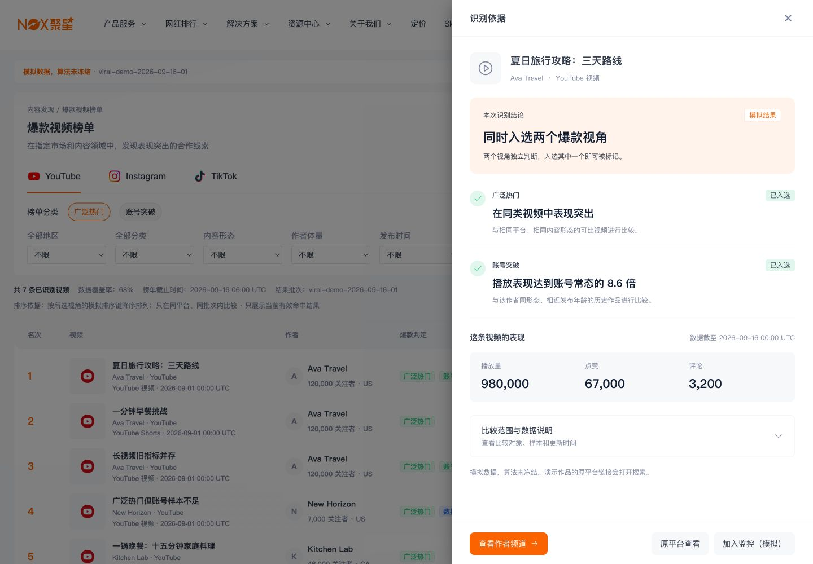

# 新增爆款视频榜单 SPEC

更新日期：2026-10-23。适用：桌面 Web。页面组织方向已确认；正式排序策略、地区语义与数据发布能力仍需定案。单视频 AI 推荐关键词按可选能力设计，是否本期启用由研发评估。本文定义应交付行为，当前 Demo 的差异列在末尾。

## 1. 页面目标与范围

让品牌在指定平台和内容范围中发现表现突出的作品，并从作品进入作者频道判断合作线索。一行代表一条视频；作品入选不等于作者合作效果或内容可复制。

- 默认广泛热门，可切换账号突破；两个视角的含义与结果契约统一引用[计算规则 SPEC](计算规则_SPEC.md)。
- 沿用聚星现有导航、筛选和列表框架，保持“平台 → 榜单分类 → 范围筛选 → 结果上下文 → 单视频表格”的组织。
- YouTube 复用 `/youtube-video-rank`。当前 Demo 在该真实路由以 `viralDemo=1` 展示三平台页签；TikTok/Instagram 正式入口和导航映射待研发确认，不虚构已存在的独立视频榜路由。
- 正式接入时明确旧 HOT 榜与新爆款榜的关系，不静默替换旧指标含义。旧榜兼容/重定向方案待路由评审。
- 不纳入作者聚合榜、连续上榜、名次升降、历史榜期、我的榜单、话题/音乐聚合、综合推荐分、预测或自动预警。

## 2. 页面结构

| 顺序 | 区域 | 展示与行为 |
| --- | --- | --- |
| 1 | 页面头部 | 面包屑、标题“爆款视频榜单”、一句用途说明、实际更新时间、“榜单说明” |
| 2 | 平台页签 | YouTube / Instagram / TikTok；沿用现有平台组织与图标 |
| 3 | 榜单分类 | 广泛热门 / 账号突破；默认广泛热门 |
| 4 | 常用筛选 | 地区、分类、内容形态、作者体量、发布时间 |
| 5 | 高级筛选 | 语言、推广属性、关键词、当前结果批次；按接口实际能力提供 |
| 6 | 生效条件 | 原 Filter Summary，支持单项移除与清空 |
| 7 | 结果上下文 | 当前列表总数、评估覆盖、截止时间、排序说明及更新异常 |
| 8 | 单视频表格 | 名次、视频、作者、爆款判定、播放量、点赞数、评论数、操作 |
| 9 | 分页/空态 | 沿用原组件，保留范围与上下文，不以普通视频补位 |

结果上下文不提供无源视频的“搜索更多同类视频”全局入口。相关内容搜索与单条视频绑定，启用时在该行“更多”中提供“AI推荐关键词”，沿用既有次要操作和推荐词选择交互，不增加完整卡片或独立区域。是否启用及隐藏规则见第 7 节。

## 3. 入榜资格与排序

### 3.1 入榜资格

服务端对当前平台、当前视角和固定结果上下文查询。只有当前视角有效命中的视频进入榜单；有效性、权限与适用形态由计算 SPEC 定义。

| 广泛热门 | 账号突破 | 广泛热门榜 | 账号突破榜 |
| --- | --- | --- | --- |
| 有效命中 | 有效命中 | 入榜，显示两个标签 | 入榜，显示两个标签 |
| 有效命中 | 未达标/不足/待识别/过期/撤销/未覆盖 | 入榜，另一视角状态注明归属 | 不入榜 |
| 未达标/不足/待识别/过期/撤销/未覆盖 | 有效命中 | 不入榜 | 入榜，另一视角状态注明归属 |
| 两视角均无有效命中 | 两视角均无有效命中 | 不入榜 | 不入榜 |

记录整体无权限或不适用时两个榜都不得入选。各视角独立消费；缺失视角不补成“未达标”或“待识别”。

榜单不提供普通列表的复杂识别状态筛选，也不提供“暂未覆盖、数据不足、待识别”等与当前视角入榜条件必然冲突的选项。覆盖情况作为范围说明；若后续增加覆盖状态筛选，只允许仍有当前有效命中的合法集合，并单独定义统计关系。

### 3.2 排序与名次

- 资格决定能否入榜，排序决定名次；解释倍数、播放量或分位不自动等于排序规则。
- 正式列表由服务端返回选定视角的顺序、分页与名次，使用已发布的排序策略版本与 `rankKey`。前端不重排、不从播放量/倍数重算名次。
- **正式排序策略尚未冻结**。研发评审需明确主排序、并列规则、稳定分页、缺少排序键的处理与可读说明后，才能验收真实名次。Demo 的模拟排序键只用于演示。
- 不在跨平台、不同用途、不同观察范围或不兼容版本间比较名次。切换平台/视角后从第一页重新展示。
- 首期播放、点赞、评论表头不提供自由排序；按原指标查找通过视频搜索完成，搜索顺序不保证复现榜单名次。
- 更新采用实际成功发布的结果；刷新只取结果，不触发采集/重新计算。每日更新、实时更新等频率须有服务端 SLA 后才能对外承诺。

## 4. 筛选与上下文

### 4.1 条件语义

| 条件 | 要求 |
| --- | --- |
| 平台 | 独立数据范围；切换时移除不适用形态/属性并提示，保留仍适用条件 |
| 榜单分类 | 切换独立 assessment 与服务端排序策略，基础业务条件保持 |
| 地区 | 当前 UI “全部地区/市场”的对象尚待确定；作者所在地、内容市场、受众地区必须独立定义，确认前不互相映射 |
| 分类 | 使用结果服务声明的内容分类，缺失/不支持不暗中转为其他分类 |
| 内容形态 | 按平台确认普通视频/Shorts/Reels 等；带货/推广属性不混成视频形态 |
| 作者体量 | 沿用产品体量分档，明确边界与搜索粉丝区间的映射，边界作者不重复/漏选 |
| 发布时间 | 约束视频发布范围，不代表指标观测时间，也不更换计算观察窗口 |
| 语言/推广属性/关键词 | 只提供后端支持的条件，不用前端当前页过滤冒充全量筛选 |
| 结果批次 | 本期展示当前成功批次；历史批次浏览不因一个下拉控件自动成为首期能力 |

所有条件在服务端按约定组合并过滤后分页；改变条件回到第一页。生效条件在摘要中完整显示，移除后结果/URL/分页同步更新。加载失败保留用户当前条件供重试，不静默清空。

### 4.2 覆盖率与结果数

“已评估”表示完成该视角的有效评估，“命中/已入选”表示达到该视角条件。用户文案不得把二者都叫“已识别”。

以当前平台、内容形态、地区、分类、作者体量、发布时间、语言、推广属性及关键词定义业务范围 S；不先以“已命中”缩小 S。

- 服务端在 S 中按平台+视频 ID 去重，并先执行权限裁剪。
- `eligible`：S 内该视角可适用的视频数。不适用对象排除；待识别、不足、未覆盖、过期/撤销留在适用分母中。无法知道全量适用数时返回未知，不用已加载页数代替。
- `evaluated`：S 内该视角结果新鲜、有效且已判定为命中或未达标的视频数。
- `hits`：S 内该视角当前有效命中的视频数。无额外结果条件时等于当前榜单列表总数。
- 覆盖率 = `evaluated / eligible`，由服务端返回；未知或零分母显示“—”。前端不从分页数据推算。
- 另一视角的覆盖单独统计，不把一个视角足够解释为两个视角都已覆盖。

界面优先显示“共 N 条入选视频 · 数据截至……”。覆盖率旁用轻量说明解释“已评估 E / 适用 A；命中 H”，避免所有计数常驻抢占主阅读路径。未知分母同时说明“覆盖范围暂不可确认”。

## 5. 视频表格与下一步操作

| 列 | 展示要求 | 操作 |
| --- | --- | --- |
| 名次 | 服务端名次，跨页连续规则与并列规则待策略定稿 | 无升降/新上榜标记 |
| 视频 | 原平台封面、标题、形态、发布日期；标题最多两行 | 封面/标题打开识别依据 |
| 作者 | 头像、名称、粉丝数、作者所在地 | 进入现有频道内容页 |
| 爆款判定 | 当前视角标签；另一视角命中再加独立标签；有证据时一条短对照 | 查看依据 |
| 播放量 | 同一指标快照，紧凑数值可查看完整值 | 不自由排序 |
| 点赞数/评论数 | 与播放同一声明快照；缺失“—”，真实零显示 0 | 不自由排序 |
| 操作 | 查看依据、更多 | 更多提供原平台查看、加入现有内容监控；可选提供该视频的“AI推荐关键词” |

- 不设置整行点击；作者、视频和更多动作彼此独立。
- 作者所在地未知显示“—”，禁止用内容市场字段补齐；若地区口径尚未确认，不给出“作者来自某市场”的推断。
- “广泛热门”与“账号突破”分别表达独立视角，不合成总分或作者等级；另一视角不足时可弱提示“账号突破：数据不足”。
- 短对照只用服务端可公开证据。账号倍数需有效正基线与同龄可比；同类位置需真实参考组证据。未提供时说明“当前未提供该项对照”，不补百分比、门槛或图表。
- “为什么入选”和“为什么排在前面”分别说明。当前缺正式排序策略时不得以入选依据冒充排名依据。
- 原平台与监控继续原权限、项目选择和配额链路；打开依据或改变筛选不创建任务、不扣配额、不触发 AI。

## 6. 共用“识别依据”抽屉

默认先回答“是什么作品、入选哪个视角、与谁比较”，具体结构如下：

1. 固定标题“识别依据”和关闭按钮，合并视频/作者身份。
2. 一句话结论；两个视角分别说明，来源榜单视角先展示。
3. 播放、点赞、评论三个主要指标，附快照观测时间。
4. “比较范围与数据说明”默认收起，包含比较对象、样本量、补充互动、观察及评估时间、限制。
5. 批次、算法/结果/排序版本位于第二级“版本信息”，默认收起。
6. 固定底部：查看作者频道为主操作，原平台查看、加入监控为次操作；正文独立滚动。

这是当前本地模拟示例，用于说明布局，不作为算法与生产数据样例。补充查看：[来源视角优先](assets/识别依据_来源视角优先.png)、[另一视角数据不足](assets/识别依据_数据不足.png)、[按需展开详情](assets/识别依据_展开详情.png)。

- 只有新鲜且有效的命中用“已入选”。失效、数据不足、待识别、不适用、未覆盖与受限分别解释，不合并成未达标。
- 两个视角均有效未达标时才可汇总为未达标；一个缺失时使用“部分识别依据暂不可用”，整条未覆盖单独说明。
- 原因码仅转为已审核的用户文案；未知码不显示翻译键，也不回退成“符合条件”。无权限不得下发隐藏指标、样本、基线、队列或内部原因码。
- 列表成功而依据请求失败时保留列表，抽屉显示失败与重试；不能把请求失败写成未覆盖。
- 折叠支持键盘 Enter，状态不只靠颜色；关闭后保留原条件、页码与位置；重新打开默认收起详情。
- 生产展示不含模拟字样；本地 Demo 保留“模拟数据，算法未冻结”，模拟作品的原平台搜索链接不冒充真实作品链接。

## 7. 跨页承接与可选 AI 推荐关键词

### 7.1 本期交付取舍

按复用频道搜索“AI推荐关键词”的能力设计，入口属于单条视频，用户确认搜索词后进入同平台视频搜索。**这是可选增强，不是榜单主流程的必交依赖。** 研发评估排期、数据可用性、原始关键词提取及推荐效果后决定本期是否启用；情况不允许则隐藏整个入口，仍按本 SPEC 交付榜单、筛选、标记与依据。

- 未启用时，列表、更多菜单及复用的相关抽屉不展示入口、禁用按钮、“敬请期待”或空占位；不以无关键词搜索替代。
- 已启用但某条视频事先可确认无有效文本、无权限或不满足现有 AI 使用条件时，按现有权限交互处理，不发起无效生成，不从作者名、播放指标或其他视频猜主题。
- 本节只定义功能与隐藏行为，不要求新增后台配置页或独立推荐系统；具体能力开关与现有权限/配额复用由研发确定。

### 7.2 推荐与确认流程

1. 用户主动点击该视频的“AI推荐关键词”；只取该源视频权限范围内可读取的标题/描述、标签等作为主题证据。现有接口支持 `videoIds`；不能直接把频道搜索结果集合与全部作者标签混作该视频主题。
2. 先保证核心主题及原始关键词提取准确，再按视频检索目的生成少量候选词。保留对象、动作、作品/角色、场景与消歧限定；避免泛流量标签、无依据的竞品/品类扩展或语种歧义。复用调用链不代表原 Prompt 可以不经适配直接使用。
3. 沿用既有推荐词选择交互，允许用户确认、修改搜索词或取消；只有用户确认有效非空搜索词后才跳转。不自动逐词执行多次搜索，不承诺“更多同类视频”或相同创意。
4. 生成中采用原操作的轻量 loading 并防重复点击，列表与榜单状态保持。无可靠候选时说明“暂无合适的推荐关键词”，允许修改/手动输入或取消；请求失败提供重试，不伪装成生成空结果。
5. 主动生成沿用现有 AI 权限与配额策略，具体规则由研发确认；仅浏览榜单、筛选、分页、打开/关闭依据或返回不触发生成与扣费。

### 7.3 搜索范围与返回

这是从作品出发查找相关主题内容，不是把全榜单筛选复制到另一个列表。默认仅传入同平台与用户确认的关键词，界面说明“使用所选关键词搜索当前平台视频”。不自动强制结果仍为爆款，不承诺搜索顺序与榜单一致。

| 上下文 | 承接要求 |
| --- | --- |
| 平台 | 与源视频一致，进入 `/search/{platform}/video` |
| 搜索关键词 | 使用用户本次确认的词，显示在原搜索框/摘要；不静默拼入榜单已有关键词或把推荐词全量按 OR 提交 |
| 形态、分类、日期、作者体量、地区、语言、推广属性 | 默认不继承；如沿用已有承接能力，须由用户确认且语义等价，搜索页完整回显、可移除，不声称自动保留所有榜单条件 |
| 爆款视角、结果批次、覆盖条件 | 保留为来源/返回上下文，不自动转成搜索约束；用户可在视频搜索中主动添加已支持的爆款筛选 |
| 返回地址 | 使用合法站内 `returnTo`，恢复榜单平台、视角、原条件、页码与位置；不接受站外地址，不用搜索侧条件覆盖原榜单 |

作者/依据下钻的返回同样保留原榜单上下文。入口整体隐藏时，本节的推荐与搜索承接不作为本期必验项，但隐藏本身必须验收。

## 8. 加载与异常状态

| 状态 | 页面行为 |
| --- | --- |
| 加载中 | 保留筛选与表头，显示 loading，不闪成 0 条 |
| 正常空榜 | 有可用评估范围但无有效命中：“本范围暂无符合条件的视频”，可调整筛选；不展示无源视频的 AI 推荐入口 |
| 整体未覆盖 | “该范围暂未完成识别”，说明覆盖限制并保留调整范围/返回能力；不称无爆款，不以空关键词跳转补位 |
| 部分覆盖 | 展示已确认的命中与覆盖说明，未评估对象不当作普通视频 |
| 批次延迟 | 有仍有效的成功批次时保留并标明实际截止时间；超过有效期不冒充当前榜 |
| 查询失败/批次不可用 | 显示失败与重试，保留条件；不返回普通视频或空数组假装成功 |
| 无权限 | 明确权限提示，先裁剪再汇总，不泄漏隐藏数量和依据 |
| 上下文过期/权限变化 | 提示重新查询，不能静默混合另一批次的名次或证据 |

## 9. 设计与实现依据

采用[设计规范 README](/Users/yukuangji/Work/NoxInfluencer/pm-workspace/kol2.0-design-specification/README.md)、[语义 token](/Users/yukuangji/Work/NoxInfluencer/pm-workspace/kol2.0-design-specification/playbook/semantic-tokens.md)、[表格](/Users/yukuangji/Work/NoxInfluencer/pm-workspace/kol2.0-design-specification/playbook/components/table.md)、[筛选摘要](/Users/yukuangji/Work/NoxInfluencer/pm-workspace/kol2.0-design-specification/playbook/components/filter-summary.md)、[标签](/Users/yukuangji/Work/NoxInfluencer/pm-workspace/kol2.0-design-specification/playbook/components/tag.md)、[按钮](/Users/yukuangji/Work/NoxInfluencer/pm-workspace/kol2.0-design-specification/playbook/components/button.md)和[可访问性](/Users/yukuangji/Work/NoxInfluencer/pm-workspace/kol2.0-design-specification/playbook/accessibility.md)。保持原页面密度，指标使用等宽数字，标题与操作不无限压缩；长文案允许合理换行，采用既有焦点/禁用/减弱动效状态，不新增视觉 token。移动端、完整五语言与多地区权限另验收。

代码归档：`Influencer/Client/kol-next` 的远端分支 `codex/viral-video-demo`，当前已推送提交 `0c46b320f`；基线为 `uat` 的 `e7bd23838`。分支推送不等于部署或生产验收。

Demo 范围仅限榜单。单视频“更多”菜单中的“AI推荐关键词”只显示方案说明：复用现有 AI 能力、先准确提取主题与限定词、确认/修改后搜索，是否本期交付由研发评估，条件不允许时隐藏入口；不生成关键词、不执行搜索。作者频道和加入监控仍提示“本 Demo 不演示后续流程”，不跳转其它模拟页面或创建模拟监控。正式产品的跨模块承接仍按本 SPEC 和《其余功能模块修改 SPEC》实施。

代码入口（均为当前本地实现依据，不证明线上已接入）：

- [榜单页面](/Users/yukuangji/Work/NoxInfluencer/pm-workspace/kol-next-viral-video-demo/pages/youtube-video-rank.vue)：平台、视角、条件、上下文和跳转。
- [表格](/Users/yukuangji/Work/NoxInfluencer/pm-workspace/kol-next-viral-video-demo/components/viralVideoDemo/ViralTable.vue)、[依据抽屉](/Users/yukuangji/Work/NoxInfluencer/pm-workspace/kol-next-viral-video-demo/components/viralVideoDemo/ViralEvidenceDrawer.vue)：单视频呈现与解释。
- [本地结果适配器](/Users/yukuangji/Work/NoxInfluencer/pm-workspace/kol-next-viral-video-demo/components/viralVideoDemo/data/adapter.js)：固定样本用于契约验证，模拟前端排序不得进入生产实现。

真实环境边界：已记录的本地 1440×1000、1280×900 抽屉检查说明当前布局可用；当时使用模拟数据、临时本地预览会话，不代表生产权限/数据/排序通过。本轮未完成线上榜单实测。正式导航、真实 API、聚合性能、全量覆盖和刷新 SLA 均待联调。

AI 推荐的设计-代码-线上校验：静态源码 `kol-next/components/searchV2/SearchBox/aiSuggest.vue` 与 `api/search/inputOption.js` 已接入 `/ws/{platform}/star/ai/keywordExpansion`；旧服务 `KeywordExpansionParam` 包含 `videoIds`，三平台搜索服务会取视频标题/描述及标签。现有 Prompt 侧重扩词找作者，视频场景的提取、限定词保留与弃权需另行适配。2026-10-23 三平台真实视频搜索已通过 Playwright MCP 同源读取，取得 30 条源视频及 2,203 条检索结果；该实验没有调用现有 AI 推荐接口，不构成此功能的效果、权限或配额验收。具体视觉沿用本节引用的 Button/Filter Summary，未新增布局和 token。

## 10. 验收与当前 Demo 差异

| 验收项 | 要求 / 当前状态 |
| --- | --- |
| 页面组织 | 保留已确认的结构和真实路由，其他模块按[其余模块 SPEC](其余功能模块修改_SPEC.md)增量接入 |
| 当前视角 | 只有该视角有效命中入榜；另一视角不足不排除，状态有归属 |
| 真实名次 | 服务端固定顺序/上下文/分页；正式排序策略未定，Demo 仅模拟 |
| 覆盖统计 | 全范围 `eligible/evaluated/hits` 及未知原因；Demo 尚缺完整分母解释 |
| 地区 | 业务定义定案；作者所在地未知不拿市场兜底，当前 Demo 仍需修正 |
| AI 推荐启用 | 原词与限定准确、用户确认后同平台检索、空文本/空推荐/失败/权限与配额行为正确；未完成现有 AI 接口联调 |
| AI 推荐隐藏 | 研发选择不交付时所有相关入口与占位均隐藏，不发生成请求，不影响榜单主流程 |
| 搜索承接 | 仅传用户确认的有效词及实际生效条件，返回恢复原榜单；当前 Demo 已移除旧全局搜索入口，单视频“更多”中展示新版方案说明；真实提词、推荐与搜索尚未接入 |
| 无覆盖空态 | 移除与入榜冲突的筛选；当前 Demo 仍有“暂未覆盖”选项，需修正 |
| 依据抽屉 | 结论优先、来源视角、分级折叠、权限/失效处理已做本地渲染验证；真实定量依据与生产联调待完成 |
| 边界与回归 | 生产真实路由消费真实结果并允许显示新标签；本地 Demo 的 mock 隔离单独验收，不能把标签永久限制在 Demo 参数后 |
| 业务操作 | 监控/导出仍使用现有权限与配额；本地模拟操作不能作为真实写入成功证据 |

完整跨模块结果与异常契约引用计算 SPEC；当前数据条件、未决事项及保留结论见[保留结论汇总](保留结论汇总.md)。以上差异是待研发完成的验收要求，不因本次文档整合宣称已修复代码。
