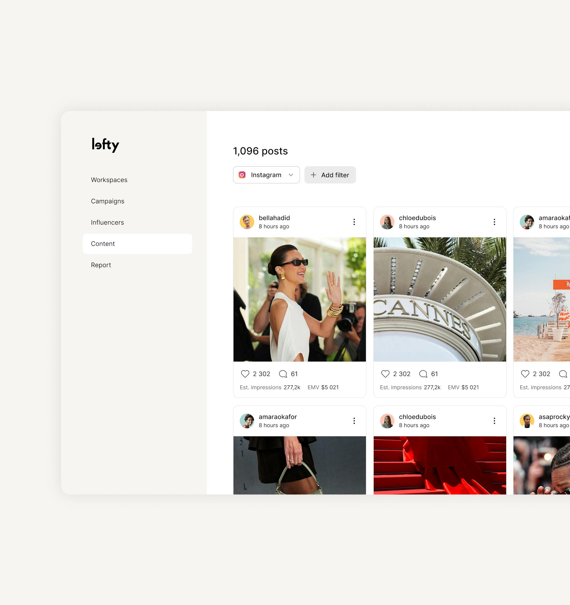
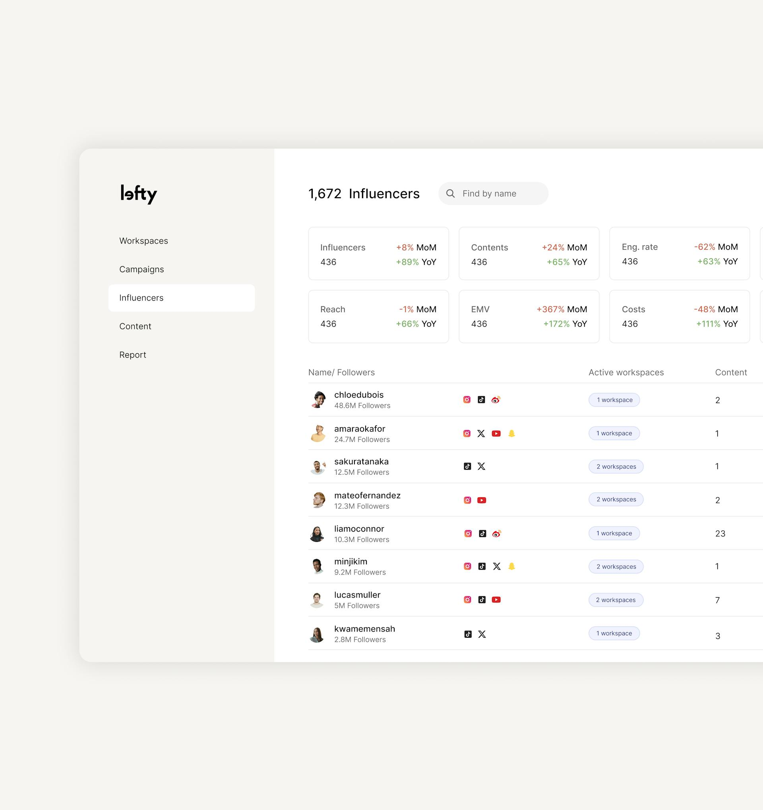
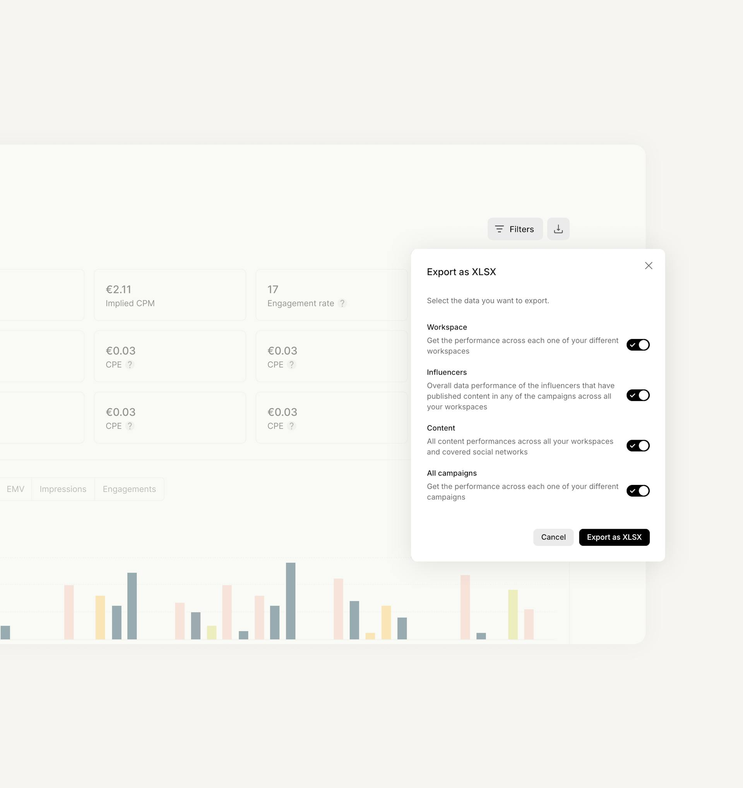

# Lefty：跨工作区报告与个人/团队布局

观察日期：2026-11-17（Asia/Shanghai）。没有登录或申请演示。参考官网产品示意图、公开帮助文档与演示入口；不是生产租户实测。证据见[evidence/lefty_cards.jsonl](evidence/lefty_cards.jsonl)。

## 1. 先区分本轮的证据强度

官网明确说跨品牌、division、market统一报告，但三张相关图片是精修的产品示意：不少KPI重复同一数字，不能当真实客户数据截图。帮助中心目前公开可见Campaigns→Reporting & Export下的卡片布局说明；其“View Demo”指向申请页，没有取得可自由操作的品牌组织演示。

因此本轮对Lefty最可靠的新补充是**报告布局如何持久化、谁受影响、导出如何跟随**；不是完整主子品牌配置的实证。

## 2. 组织与分项：图片究竟展示什么

[官网报告页](https://lefty.io/features/influencer-reporting)的三张图已实际审看（L202）。

| 图 | 具体可见 | 不可推导 |
|---|---|---|
| 内容网格 | 左侧Workspaces、Campaigns、Influencers、Content、Report并列；内容页有平台选择与Add filter | 点击某品牌后内容范围如何变化 |
| 跨工作区达人表 | KPI卡、达人逐行、Active workspaces列中1或2个workspace | 同达人跨workspace的总体如何去重 |
| 导出面板 | XLSX可勾Workspace、Influencers、Content、All campaigns；说明跨workspace的数据维度 | 这些维度等于集团/子品牌实体层级，或可保存任意品牌组合 |

特别说明：图片相邻文案不等于图片当前页。第一个素材在汇总文案下，但图内实际是Content页面；第二个素材在高表现内容文案下，但图内是Influencers。以下按图内可见内容命名。

## 3. 保存定制视图：新增帮助文档的具体机制

[Showing and hiding metric cards on Campaign and Directory reports](https://help.lefty.io/en/articles/18250173-showing-and-hiding-metric-cards-on-campaign-and-directory-reports)（L203–204）说明两类布局：

| 报告 | 配置动作 | 保存范围 | 权限/副作用 |
|---|---|---|---|
| Campaign report | 在Overview悬停卡片并隐藏；通过Add metric重新选择 | 每个campaign一份共享布局，各campaign独立 | 可编辑campaign者可改；Viewer不可改；隐藏部分卡片会移除Excel相应列 |
| Directory report | 同样隐藏/恢复卡片 | 绑定个人账户，跨设备和下次登录保留 | 包含Viewer的每个用户可改自己的；PDF跟随个人布局 |

这意味着Lefty并不是所有“定制”都需要新建dashboard：有一类是**现成报告里的卡片可见性偏好**。隐藏不改变指标计算；导出可能随布局变化。共享链接看团队设定的布局，外部查看者不能改。

本页没有真实配置截图，只有logo和信息图标；本轮未把它们当成UI证据，也未执行保存/重新登录。Directory是否对应当前组织总览页面，公开证据不足，不能自行合并两者。

## 4. 能还原的操作链与缺口

- **官方宣称的业务链**：各品牌/地区/部门workspace独立工作→获授权者跨团队看报告→查看内容/达人→导出或分享。
- **本轮图中可见链**：Workspaces等并列导航→内容/达人视图→选择导出维度。图与图之间没有真实点击衔接。
- **文档确认的布局链**：报告Overview→隐藏/恢复卡片→按活动共享或按个人保存→导出跟随展示。

尚缺：workspace创建/品牌挂接表单、静态/动态品牌范围、集团总量与分项同口径、品牌分项到内容的点击结果、多个保存视图命名列表、成员变化和历史口径。没有这些证据不能声称Lefty不支持，只能说明公开资料尚不足。

## 原图

均为官网产品示意，非本次操作的产品截图：

具体来源、URL与状态见证据卡；[官网申请演示](https://lefty.io/demo-request)未提交。
