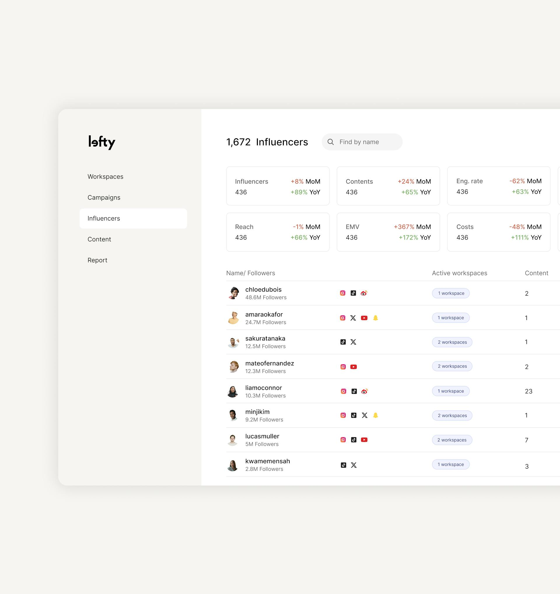
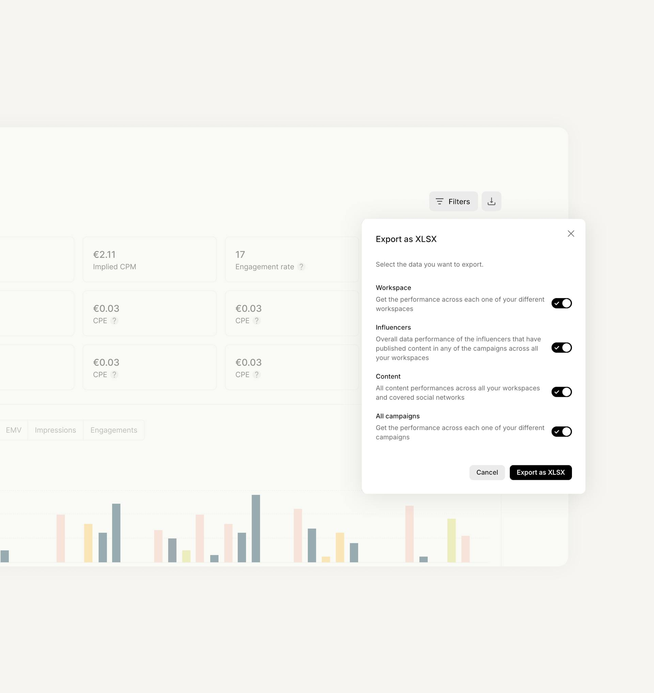
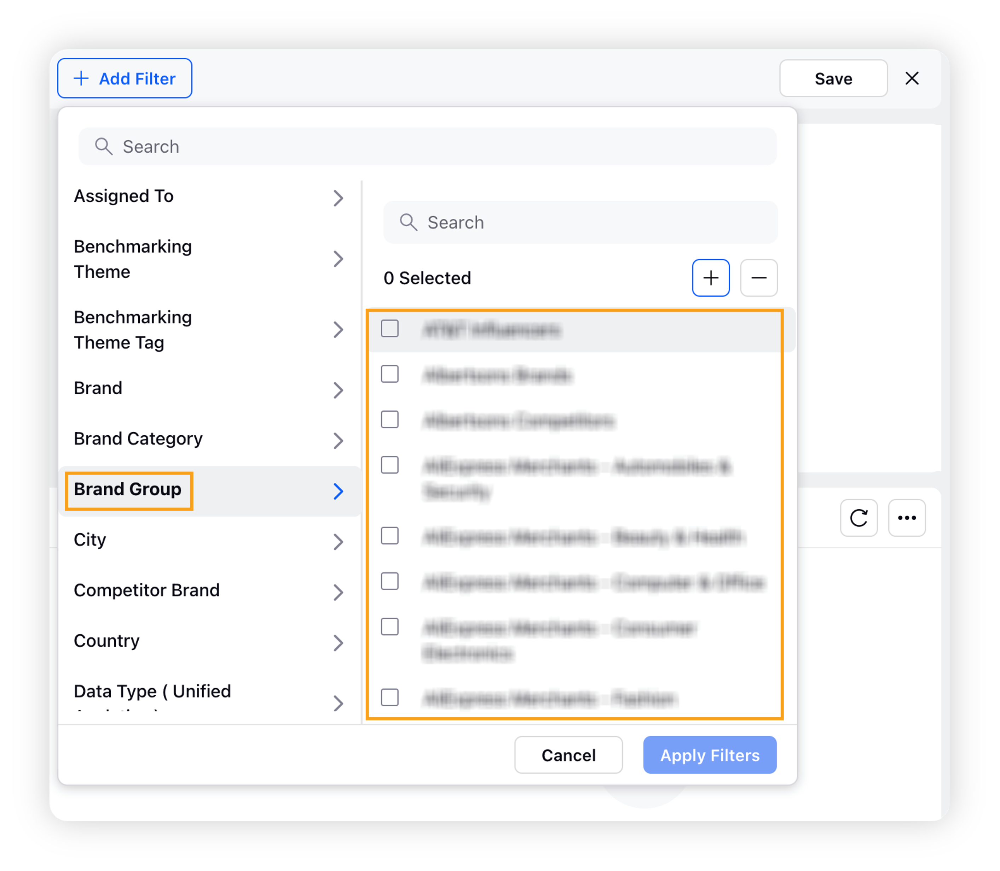
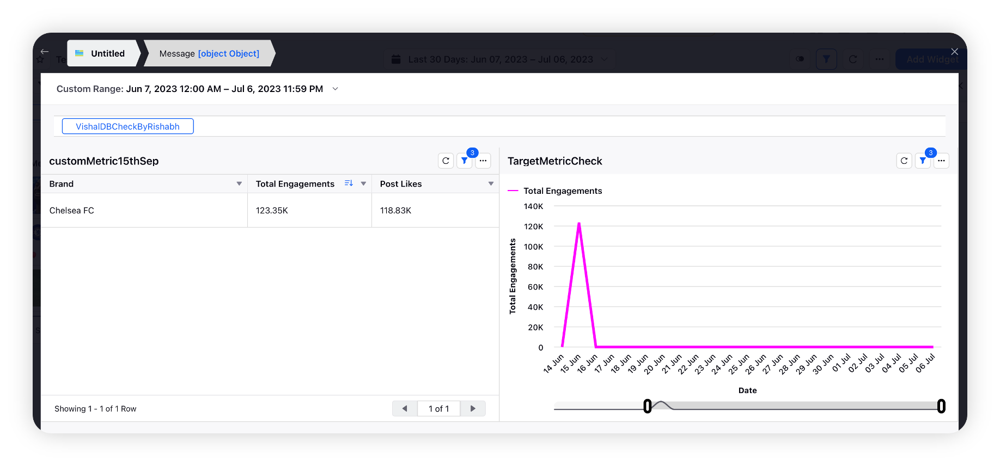
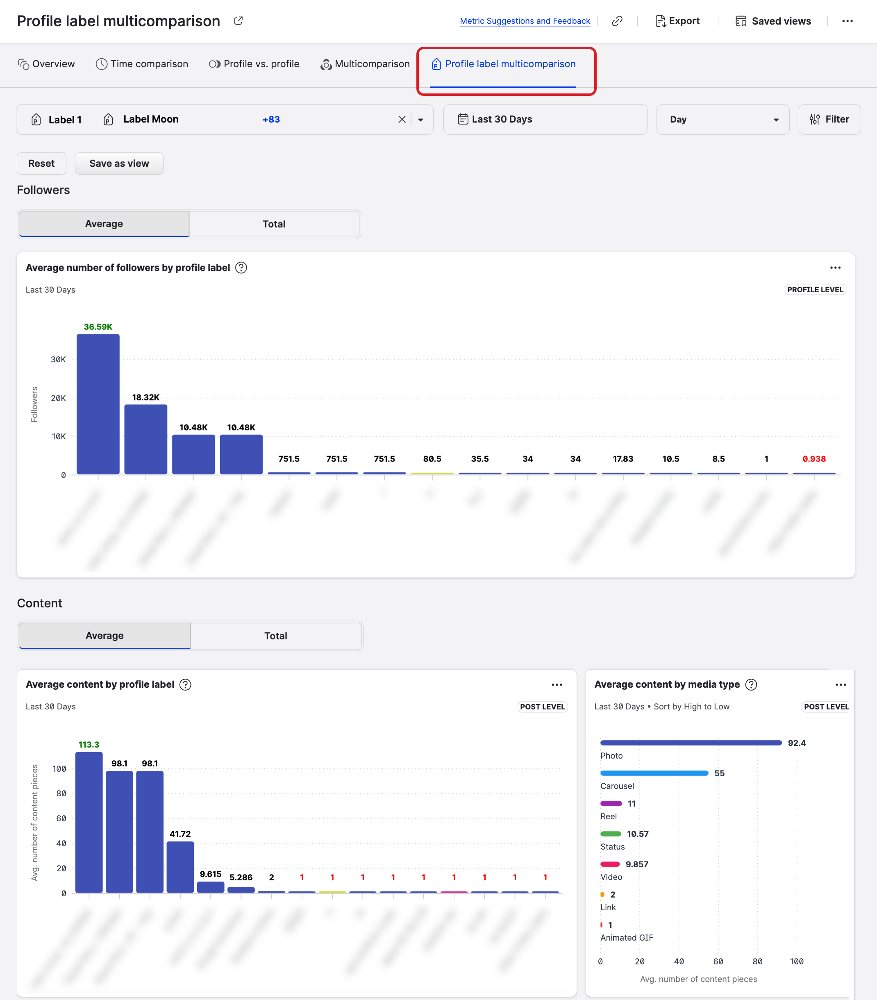
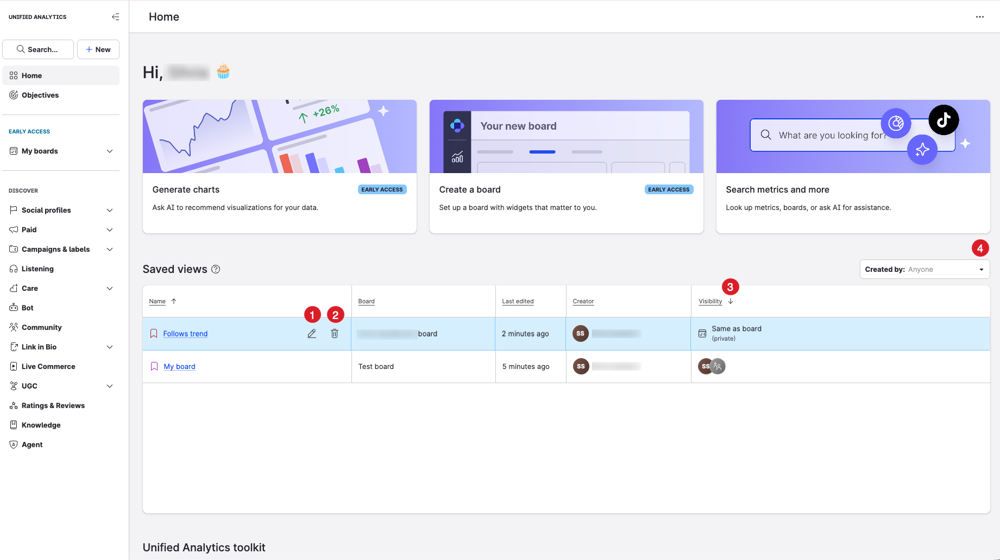
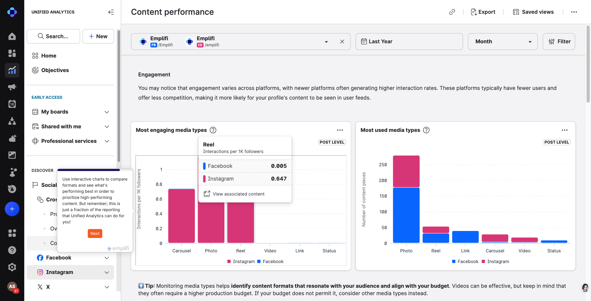
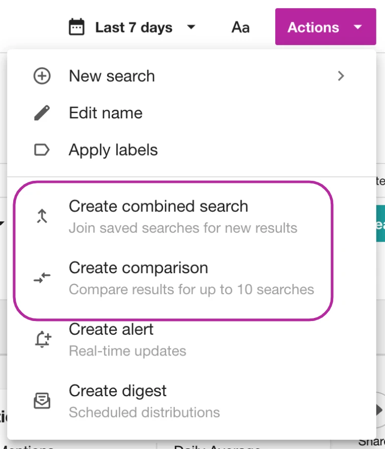
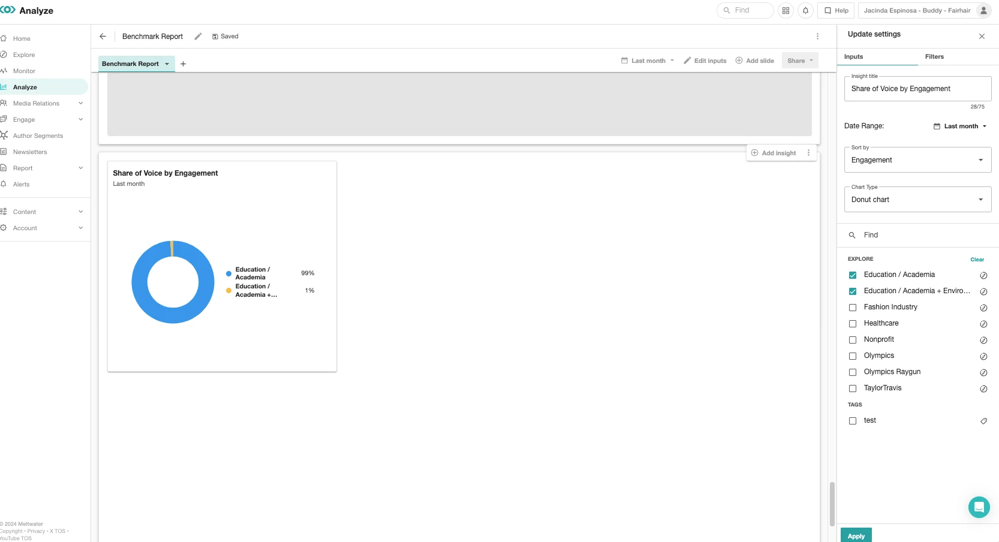
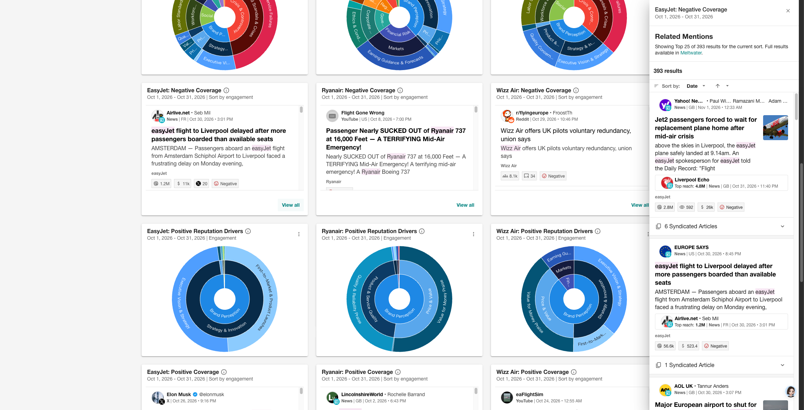

# 官方界面证据导览

观察日期：2026-11-17。下面保留原图和操作截图，不重绘竞品界面；图片内红/橙标记与模糊来自官方素材。营销示意、文档截图、公开导览捕获、公开共享报告实点分别标注。按钮可见不等于点击结果已验证。

## Lefty：跨工作区达人和导出维度

**官网产品示意图，非真实租户截图。** 可看Active workspaces列，以及按workspace、达人、内容、campaign导出；不能由图确认品牌父子归属。L202，[来源](https://lefty.io/features/influencer-reporting)。

## Sprinklr：现成品牌组筛选与定制详情层

**官方帮助文档截图，未亲自配置。** 先通过Brand Group多选圈范围；详情层由Explore Lens指定dashboard呈现。S201/S204，[品牌组来源](https://www.sprinklr.com/help/articles/entities/what-are-brand-groups/645dae4fe66f2e36b4518f65)、[Lens来源](https://www.sprinklr.com/help/articles/advanced-concepts/explore-lens-in-benchmarking/64a69cf2564e3e25f8040adf)。

## Emplifi：集合分项、总量开关与保存入口

**官方文档截图。** 多label比较中每指标区各自有均值/总量开关，当前为均值选中；上方有保存入口。图中品牌名模糊，不补造真实组织关系。E202，[来源](https://docs.emplifi.io/platform/latest/home/compare-profile-labels)。

**官方文档截图。** 已保存视图表展示所属board与可见性。E206，[来源](https://docs.emplifi.io/platform/latest/home/managing-saved-views)。

**本轮走过公开导览的捕获画面。** 可见内容图表的关联内容入口；未点击到Content Hub结果。UIE201，[官方导览](https://capture.navattic.com/cmi556q9e000004kz6euo8dz0)。

## Meltwater：Combine/Compare、输入设置与实际明细

**2024官方操作截图。** Actions把组合搜索与比较分列，按钮限制只代表该历史截图。M201，[来源](https://community.meltwater.com/singapore-community-106/weekly-product-highlight-new-improved-explore-homepage-2563)。

**2024官方答疑截图。** 右侧Inputs选搜索，左侧组成报告；原search与其子集会重叠，此图不能读成互斥品牌贡献。M208，[来源](https://community.meltwater.com/meltwater-launch-125/best-ways-to-pull-data-in-meltwater-2762)。

**本轮实际点开的官方公开共享报告。** 在三品牌并列报告点击View all，右侧成功加载Related Mentions。只借报告组织与明细机制；该样例业务主题是口碑/竞品，不扩展本项目到舆情。UIM202，[官方入口与访问说明](https://community.meltwater.com/p/use-case-playbooks)。

截图同时保留一项待核：标题期间到10月31日，首条卡显示11月1日00:33。原因未知，不判定过滤已通过或产品缺陷。

更多原图、视频和链接见各产品记录；[浏览器过程](browser_walkthrough.md)明确哪些操作没有完成。
